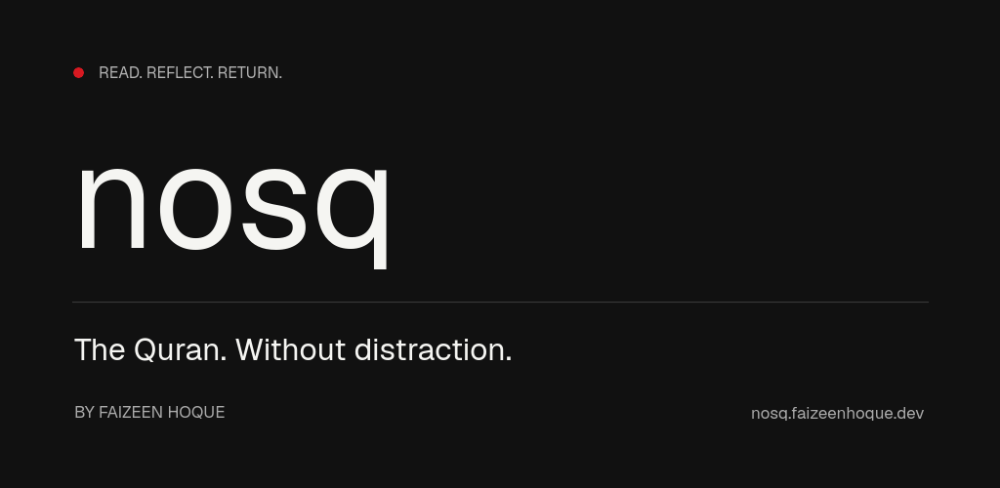
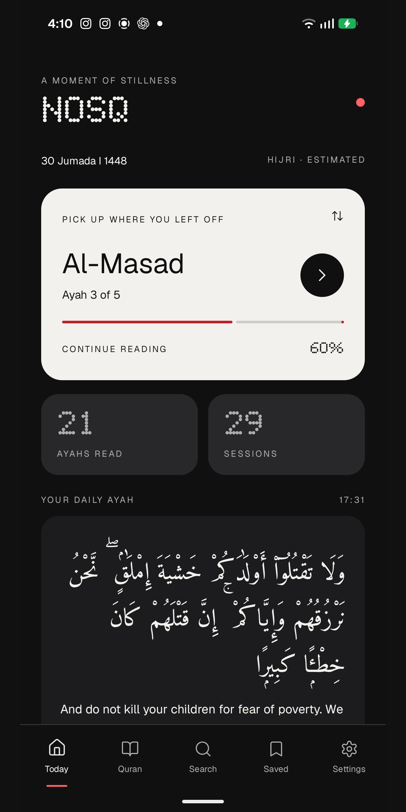
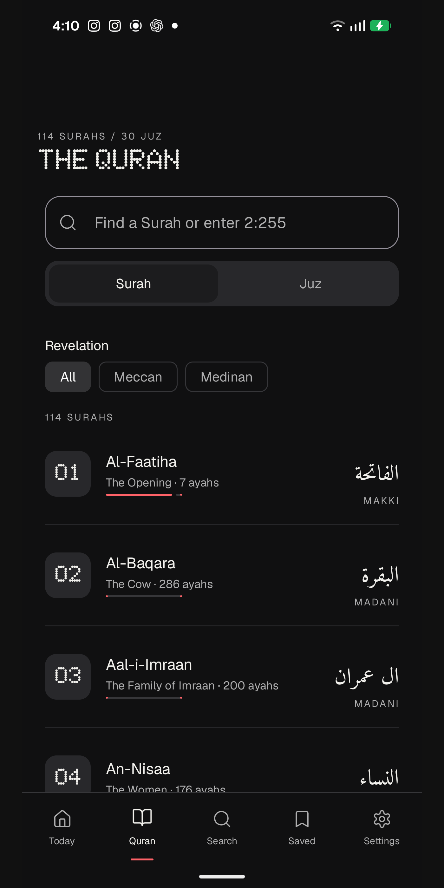
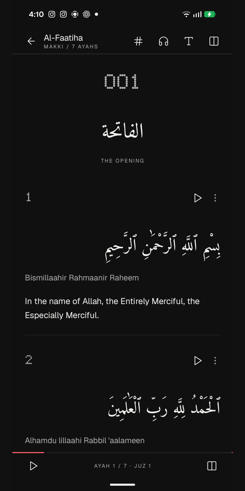
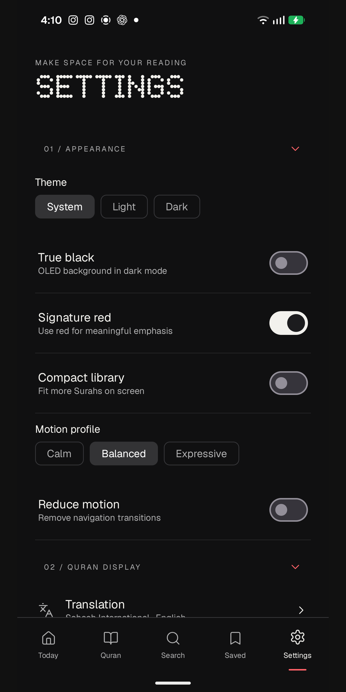

<div align="center">



### A quiet reading instrument for Android.

Offline Quran reading. Thoughtful recitation. Room for reflection.

[](#build)
[](#inside-nosq)
[](https://github.com/FaizeenHoque/Nosq/releases)

[**Download APK**](https://github.com/FaizeenHoque/Nosq/releases) · [Website](https://nosq.faizeenhoque.dev) · [Developer](https://faizeenhoque.dev) · [Support](mailto:me@faizeenhoque.dev)

</div>

## Read. Reflect. Return.

**nosq** is a native Kotlin and Jetpack Compose Quran application by **Faizeen Hoque**. Its monochrome surfaces, precise typography and restrained red accents draw inspiration from Nothing OS. The reading experience stays at the center: clear Arabic text, useful controls and a saved place to return to.

An independent project. Not affiliated with Nothing Technology.

## A closer look

| Home | Quran library | Reader | Settings |
| :---: | :---: | :---: | :---: |
|  |  |  |  |

Actual captures from the application. Reading activity and device details reflect the captured session.

## Inside nosq

| Read | Listen | Keep |
| :--- | :--- | :--- |
| All **114 Surahs** and **6,236 ayahs** offline | Searchable **EveryAyah** and **MP3Quran** catalogs | Bookmarks and custom collections |
| Arabic with English or Bengali translation | Individual-ayah playback for verse editions | Personal notes and reflections |
| Optional transliteration and adjustable type | Follow the recited ayah in Scroll or Pages layout | Bookmark import and export |
| Surah/Juz browsing and reference search | Background playback and system media controls | Reading position, history and reminders |

Light, dark and OLED appearances. Calm, Balanced and Expressive motion. Reduced-motion support. No app account, advertising or analytics SDK.

Full-Surah recordings are labeled separately and have no verse timings. Audio requires connectivity until downloaded. Page mode displays one ayah at a time. Tafsir opens published commentary in a browser; offline Tafsir is not bundled. The interface is English; Bengali is a translation option.

## Install a preview

1. Open [Releases](https://github.com/FaizeenHoque/Nosq/releases) and choose a preview.
2. Download its `.apk` and, if desired, verify it against `SHA256SUMS.txt`.
3. Allow installation from your chosen browser/file manager when Android prompts.

Requires **Android 8.0 / API 26 or newer**. Preview APKs use a development signing certificate and are not a Google Play production release. A future production signing identity may require uninstalling a preview; export your bookmarks and notes first. Repository and release access follow the repository's visibility settings.

## Build

Use the Gradle wrapper, Android SDK 37 and a compatible JDK (this workspace was validated with JDK 25):

```sh
./gradlew :app:assembleDebug
```

APK: `app/build/outputs/apk/debug/app-debug.apk`.

```sh
# Existing JVM data tests; this task does not run device benchmarks.
./gradlew :app:testBenchmarkUnitTest

# Optimized, unsigned production artifacts and release lint.
./gradlew :app:bundleRelease :app:assembleRelease :app:lintRelease
```

Application ID: `dev.faizeenhoque.nosquran`. Release signing requires your own upload key. Do not commit keystores or credentials.

## Quran text and distribution rights

Arabic uses the Uthmani / Hafs text with Kufan numbering. Bundled English, Bengali and transliteration editions are attributed in the [Quran data notice](app/src/main/assets/quran/NOTICE.txt). Audio provenance and capability boundaries are in the [audio notice](app/src/main/assets/audio/NOTICE.txt). The [verification tool](tools/verify_quran.py) and data tests support structural and source comparison checks.

**Distribution rights are not fully cleared.** NDot font redistribution permission and translation/transliteration permissions require confirmation. Audio/download terms must be reviewed for the intended distribution. No blanket open-source license is asserted for this repository or its third-party content. Keep all required attributions and notices intact.

## Project notes

- [Design foundations](docs/DESIGN.md)
- [Motion system](docs/MOTION.md)
- [Navigation, recitation follow and catalog details](docs/OVERHAUL.md)
- [Implementation and verification history](docs/IMPLEMENTATION.md)

Local bookmarks, notes and preferences may participate in Android backup according to system settings. Recitation/catalog requests contact third-party providers; see the app's privacy information. Preview builds still need comprehensive signed-release device and accessibility testing. No frame-rate or zero-lag guarantee is made.

---

<div align="center">

Made by [**Faizeen Hoque**](https://faizeenhoque.dev)<br />
[nosq.faizeenhoque.dev](https://nosq.faizeenhoque.dev) · [me@faizeenhoque.dev](mailto:me@faizeenhoque.dev)

</div>
